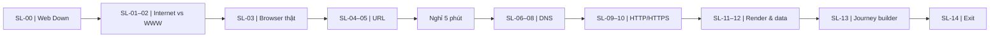

# Skill 09 – Slide Map / Bản đồ màn hình học tập

**Lesson:** 5.1 Internet & World Wide Web · **Skills:** v3.2 · **Design only / chưa lập trình**  
**Source:** Skill 03 (9 OBJ, 15 KU), Skill 05 v3.2 assets, Skill 06 (5512), Skill 07 scenarios; **Skill 08 chưa chạy theo yêu cầu người dùng**.  
**Time:** 15 slides nội dung = 115 phút, 1 trạng thái nghỉ 5 phút, tổng 120 phút.  
**Design principle:** không chuyển bốn giai đoạn 5512 thành bốn màn hình; một nhiệm vụ chính/slide; recall ngắn tích hợp ở cuối nội dung, không thêm các màn quiz lặp lại.

## Tổng quan luồng

## Slide map chính

| Slide | Hoạt động (phút) | Mục tiêu một câu | Học sinh thực hiện | Học liệu | Trạng thái vào → ra | Bằng chứng / điều kiện chuyển | Ghi chú GV |
|---|---|---|---|---|---|---|---|
| **SL-00** · The Web Is Down! | ACT-00 (8') | Phân loại dự đoán có điều kiện, ghi lý do và mức chắc chắn | Chọn 1 trong 3 trạng thái cho sáu tình huống, viết lý do, được phép sửa | A00-CASES | `caseConditions` → `predictions, openQuestion` | **EV-DIAG**: Ghi ít nhất 1 lý do và 1 câu hỏi còn băn khoăn; không ép đáp đúng | Không chấm điểm kiến thức chưa học; không công bố định nghĩa Internet/WWW. |
| **SL-01** · Evidence desk | ACT-01 (8') | Tự nghiên cứu bằng chứng phân biệt mạng và tài nguyên Web | Đọc CARD-01/02, chọn bằng chứng, vẽ hoặc xếp khái niệm | CARD-01, CARD-02 | `openQuestion` → `conceptClaims, networkMapDraft` | **EV-01**: Có ít nhất hai nhận định sơ bộ kèm nguồn bằng chứng | Thẻ bằng chứng mở theo yêu cầu, không điền đáp án vào sơ đồ trước. |
| **SL-02** · Defend and revise | ACT-01 (5') | Giải thích và tự sửa quan hệ Internet–WWW | Giảng sơ đồ, xử lý phản ví dụ webmail; tự nhớ lại qua 3 cue và ghi vở | V01, CARD-01, CARD-02 | `networkMapDraft, conceptClaims` → `networkMapFinal, conceptReflection, recall01` | **EV-01**: Học sinh đã trình bày và có cơ hội đối chiếu bằng chứng; mức đạt do GV đánh giá | Mở V01 sau khi học sinh trình bày, không tiết lộ sơ đồ chuẩn quá sớm. |
| **SL-03** · Real Browser Mission | ACT-02 (15') | Tự khám phá công cụ truy cập Web trên trình duyệt thật | Thao tác Chrome/Edge/Firefox; quay lại ghi mục đích→công cụ→kết quả; recall ngay ở cuối | B01, CARD-03, A02-HINTS | `networkMapFinal` → `browserObserved, browserUrlExample, recall02` | **EV-02**: Thao tác thực được quan sát; người học tự giải thích ≥3 chức năng | Không virtual browser; không tự kiểm tra history hay bookmark bằng JS của bài học; browser offline qua file:// không phải DNS/HTTP. |
| **SL-04** · Compare URL examples | ACT-03 (8') | Nhận diện điểm chung và khác của các URL | Quan sát URL thật đã dùng, so U1/U2; mở CARD-04, gắn nhãn U3/U4 | CARD-04, A03-URL | `browserUrlExample` → `urlHypothesis, urlLabels` | **EV-03**: Có nhận định host/path và bằng chứng đối chiếu | Không mở URL ví dụ trên mạng thật; các địa chỉ example.org chỉ là tài liệu. |
| **SL-05** · URL transfer | ACT-03 (7') | Áp dụng quy tắc với URL chưa gặp và trường hợp ngoại lệ | Phân tích U5; phát biểu không bắt buộc www/.html; recall trên URL chưa tô màu | V02, CARD-04 | `urlLabels, urlHypothesis` → `parsedReferenceUrl, dnsHost, recall03` | **EV-03**: HS phân tích URL lạ và nêu lý do; cho xem V02 sau khi thử | Cố định host bài học mô phỏng school.example.org để bước DNS nhất quán. |
| **SL-06** · DNS question and prediction | ACT-04 (4') | Dự đoán tác động của cache và tên miền không tồn tại | Đọc điều kiện ba ca DNS-A/B/C; ghi dự đoán trước khi chạy | CARD-05, SIM01 | `dnsHost` → `dnsPrediction` | **EV-04**: Đã dự đoán tối thiểu ca A/B; chưa cần đúng | Hiển thị rõ là simulated; không tự lookup DNS thật. |
| **SL-07** · DNS Evidence Lab | ACT-04 (11') | Điều tra A/B/C, thu log và giải thích khác biệt | Chọn ca, Step/Run/Pause/Reset; quan sát event log; điền bảng bằng chứng | SIM01, A04-GIF | `dnsPrediction, dnsHost` → `dnsTrials, dnsSelectedAnswer, dnsExplanation` | **EV-04**: A/B có log và lời giải thích; C được làm nếu còn thời gian | A04-GIF chỉ minh họa sau dự đoán. Khi chưa có lab chạy bằng fixture log và thẻ sự kiện. |
| **SL-08** · DNS conclusion | ACT-04 (3') | Phân biệt DNS trả địa chỉ và lỗi DNS so với HTTP 404 | So sánh A/B/C, trả lời phản biện, recall domain/IP/cache | CARD-05 | `dnsTrials` → `dnsConclusion, recall04, chosenResolvedAddress` | **EV-04**: Có kết luận có dẫn log; lỗi NXDOMAIN không được sinh IP | Nếu ca C đang được chọn thì nhắc quay về A/B trước khi nối sang HTTP. |
| **SL-09** · Request–response workshop | ACT-05 (10') | Phân tích chiều trao đổi GET/response với 200 và 404 | Dự đoán rồi Step/Run các message, gắn sender/receiver, ghi status | SIM01, CARD-06, A05-GIF | `chosenResolvedAddress, parsedReferenceUrl` → `httpCases, httpEvidence` | **EV-05**: Có bằng chứng về request/response và giải thích 200/404 | Nếu chưa có địa chỉ ví dụ hợp lệ, chỉ chạy ca tách rời đã gắn nhãn, không tiếp nối giả. |
| **SL-10** · HTTPS claim check | ACT-05 (8') | Giải thích chính xác HTTPS bảo vệ gì, không chứng minh gì | Phân tích ca HTTP/HTTPS giả lập; tự lập luận về độ tin cậy nội dung; recall | CARD-07, SIM01 | `httpEvidence` → `httpsClaim, recall05` | **EV-05**: Nêu một điều HTTPS hỗ trợ và một điều HTTPS không bảo đảm | Không thể hiện mô phỏng như packet capture TLS thật; không coi khóa là bằng chứng nội dung đúng. |
| **SL-11** · Same HTML, different experience | ACT-06A (6') | So sánh HTML/CSS/JS trong cùng nội dung | Quan sát nội dung chưa style → áp CSS → nhấn nút bật JS; ghi thay đổi | CARD-08, V03, SIM01 | `httpCases` → `renderObservations, renderTrial` | **EV-06**: Nêu được khác biệt cấu trúc, trình bày, hành vi trên cùng nguồn HTML | V03 là ảnh giải thích sau quan sát; mô hình tương tác cần đảm bảo HTML giữ nguyên giữa S1/S2. |
| **SL-12** · What does the browser remember? | ACT-06A (4') | Phân biệt bookmark/history/cache/cookie | Phân loại bốn ca, giải thích một lựa chọn; recall HTML/CSS/JS và history/cache | CARD-09 | `renderObservations, browserObserved` → `browserDataMatch, recall06` | **EV-06**: ≥3/4 phân loại đúng và giải thích được; chưa đòi hỏi cookie chuyên sâu | Không thu cookie/history thật; không giả định private mode vẫn ghi history. |
| **SL-13** · Build and Teach the Web Journey | ACT-06B (13') | Tích hợp bằng chứng thành sơ đồ có điều kiện và giảng lại | Sắp khối có mũi tên và nhánh; học sinh giảng 2–3 phút; tự sửa sau phản biện; recall | CARD-10 | `parsedReferenceUrl, dnsTrials, httpCases, renderTrial, networkMapFinal` → `journeyGraph, teachBackNotes, recall07` | **EV-07**: Có ≥5/6 vai trò, ≥1 nhánh có căn cứ; ghi mức hỗ trợ H0–H3 | Không khóa thứ tự như một chuỗi luôn bắt buộc; DNS khi cần, 404 có thể render trang lỗi. |
| **SL-14** · Exit ticket | ACT-07 (5') | Đánh giá chuyển giao độc lập và xác định nội dung cần ôn | Phân tích URL mới; viết giải thích gọn về DNS/HTTP/render & HTTPS; tự chấm M1–M4 | 07-student-task-sheets | `journeyGraph` → `exitSubmission, selfRating, reviewNeeds` | **EV-EXIT**: Học sinh nộp câu trả lời mà không xem đáp án trước; GV đối chiếu rubric | Homework từ Skill08 chưa có; chỉ ghi danh sách mục cần ôn, không tự tạo bài giao hoàn chỉnh. |

**BREAK-05 (51–56 phút):** không tính là slide kiến thức; cho phép nghỉ không khóa, màn hình tối giản và dừng mô phỏng/hoạt ảnh; có nút tiếp tục khi người dạy và học sinh sẵn sàng. Không bắt học sinh xem thêm nội dung.

## Mốc thời gian kiểm chứng

| Chặng | Slide | Số phút |
|---|---|---:|
| ACT-00 | SL-00 | 8 |
| ACT-01 | SL-01, SL-02 | 8 + 5 = 13 |
| ACT-02 | SL-03 | 15 |
| ACT-03 | SL-04, SL-05 | 8 + 7 = 15 |
| BREAK | BREAK-05 | 5 |
| ACT-04 | SL-06, SL-07, SL-08 | 4 + 11 + 3 = 18 |
| ACT-05 | SL-09, SL-10 | 10 + 8 = 18 |
| ACT-06A | SL-11, SL-12 | 6 + 4 = 10 |
| ACT-06B | SL-13 | 13 |
| ACT-07 | SL-14 | 5 |
| **Tổng** | **15 slide + 1 nghỉ** | **120** |

## Ba nguyên tắc tránh rườm rà

1. **Không cần một “màn kết luận” riêng sau mọi màn:** recall → nói → ghi vở → kiểm tra ngay trong slide kết thúc chặng, không nhân đôi số màn.
2. **Không khóa điều hướng để ép click:** chỉ khóa *tiết lộ kết quả thí nghiệm* trước khi dự đoán nếu phù hợp; người học/giáo viên có thể quay lại nguồn.
3. **Không dùng “hồ sơ” thành sidebar chiếm chỗ:** nút `My evidence / Hồ sơ của em` mở ngăn nhỏ có thể đóng và xem lại khi cần; ở chặng tổng hợp, nó trở thành nguồn dữ liệu dựng mô hình.

## Điểm tích hợp bài tập về nhà – CHƯA HOÀN THIỆN

Skill 08 chưa chạy. Sau `SL-14`, chỉ đặt **handoff slot `HW-08-PENDING`** (nội dung chưa xác định). Không đưa thẻ flashcard, rubric chấm, số bài, thời gian hay lời giải chưa được tạo. Khi có Skill 08, quyết định trang tách biệt hay phiếu ngoài website dựa vào giá trị sư phạm, không mặc định thêm một slide dài.