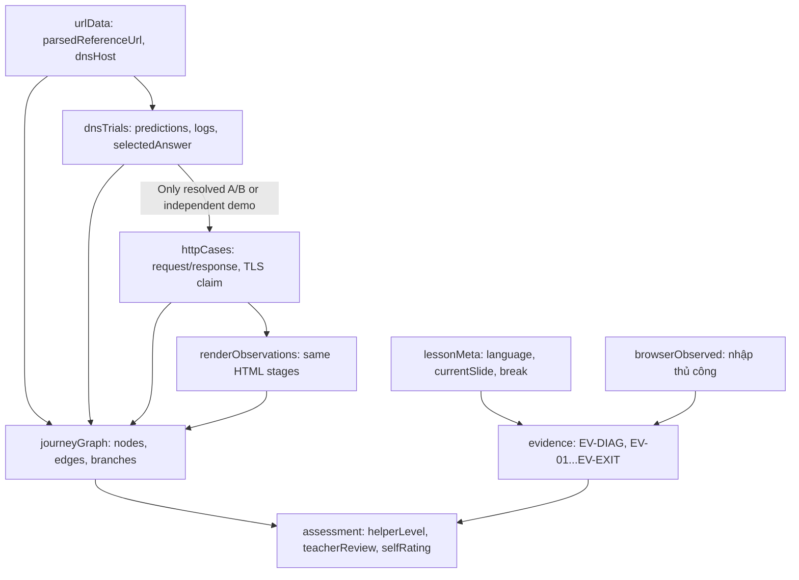

# Skill 09 – State Model / Mô hình trạng thái và phụ thuộc

## 1. Nguồn chân lý của trạng thái

Website dùng một **lesson store** nội bộ (vanilla JavaScript, in-memory mặc định). Không tự truy cập mạng, lịch sử duyệt web hay tài khoản cá nhân. Nếu cần lưu dài hạn thì **chỉ khi người dùng chủ động cho phép**, ưu tiên xuất/nhập dữ liệu không nhạy cảm dưới dạng file; không nói có đồng bộ cloud.



## 2. Type definitions đề xuất (schema, chưa phải JS đã viết)

```ts
// Specification only. Plain HTML/CSS/vanilla JS implementation in Skill 11.
type Language = 'vi' | 'en';
type HintLevel = 'H0' | 'H1' | 'H2' | 'H3';
type EvidenceStatus = 'draft' | 'submitted' | 'reviewed';
type Evidence = {
  id: 'EV-DIAG' | 'EV-01' | 'EV-02' | 'EV-03' | 'EV-04' | 'EV-05' | 'EV-06' | 'EV-07' | 'EV-EXIT';
  answer: unknown;
  support: HintLevel;
  citedSources: string[];
  reflection?: string;
  status: EvidenceStatus;
  teacherVerdict?: 'M1' | 'M2' | 'M3' | 'M4' | 'notObserved';
};
type LessonState = {
  activeSlideId: string;
  language: Language;
  currentActivity: string;
  teacherNotesOpen: boolean;
  sourceDrawerOpen: boolean;
  evidenceDrawerOpen: boolean;
  evidence: Record<string, Evidence>;
  browserObserved: Record<string, {reported: boolean; teacherObserved: boolean; reason?: string}>;
  referenceUrl: 'https://school.example.org/library/books';
  parsedReferenceUrl?: {scheme: 'https'; host: 'school.example.org'; path: '/library/books'};
  dns?: {trialId: 'DNS-A' | 'DNS-B' | 'DNS-C'; phase: string; events: string[]; answerIP: string | null};
  http?: {scenario: 'HTTP-200' | 'HTTP-404'; transport: 'HTTP' | 'HTTPS'; phase: string};
  rendering?: {stage: 'HTML_ONLY' | 'HTML_CSS' | 'HTML_CSS_JS'; buttonClicked: boolean};
  journeyGraph?: {nodes: string[]; edges: unknown[]; branches: unknown[]};
  homework?: {status: 'PENDING_SKILL_08'};
};
```

## 3. Dependency / hợp đồng dữ liệu giữa slide

| Nguồn | Đầu ra thật | Người nhận | Guard | Không được làm |
|---|---|---|---|---|
| SL-00 | Dự đoán và câu hỏi | SL-01 | Không yêu cầu đúng toàn bộ | Tự điền định nghĩa |
| SL-01 | Bằng chứng khái niệm | SL-02 | Còn draft vẫn được sửa | Auto kết luận từ vài click |
| SL-03 | `browserObserved`, URL minh họa đã chọn | SL-04 | Dữ liệu quan sát từ browser thật ghi thủ công | Đọc history/bookmark cá nhân |
| SL-04/05 | `school.example.org`, `/library/books` bài học | SL-06 | Không fetch tên miền ví dụ | Nhận URL ví dụ là web live |
| SL-06/07/08 | DNS A/B answer `192.0.2.10` | SL-09 | `answerIP !== null` **và** trial A/B | Dùng IP của A khi đang chọn C |
| SL-07/08 | DNS C `NXDOMAIN`, `answerIP=null` | SL-09 | Không chạy tiếp HTTP trong cùng đường đi | Tạo HTTP 404 từ NXDOMAIN |
| SL-09/10 | HTML body cho ca 200 hoặc ca 404 | SL-11 | Cần nêu đúng ca đang xét | Âm thầm đổi ca hoặc response |
| SL-11/12 | Quan sát HTML/CSS/JS & dữ liệu lưu | SL-13 | Mở lại evidence được phép | Cho rằng 1 HTTP response là mọi resource |
| SL-13 | Graph + teach-back | SL-14 | Có thể trở lại chỉnh | Tự chấm giảng lại qua số nút |
| SL-14 | `reviewNeeds` | HW-08-PENDING | Chờ Skill 08 | Tự sinh bài/đáp án chưa thiết kế |

## 4. Quy tắc về điều hướng và vòng đời trạng thái

- `NAVIGATE_NEXT/BACK/GOTO`: đổi `activeSlideId` mà không xóa dữ liệu HS. Phải giữ focus ở tiêu đề slide; có nút xem bằng chứng cũ.
- Khi đổi EN/VI, **chỉ đổi ngôn ngữ hiển thị**, không reset lựa chọn, log hoặc dữ liệu nghiên cứu.
- Khi đổi thử nghiệm DNS/HTTP, reset **mô phỏng hiện tại**, giữ evidence và reflection đã viết. Nếu cần so sánh, lưu log A/B/C theo khóa riêng.
- Khi reset mô hình, hỏi xác nhận nếu có thể mất lời giải HS; khác với reset animation đơn thuần.
- In-memory mặc định để bảo vệ riêng tư; reload có thể mất dữ liệu nếu chưa chủ động xuất. Ghi rõ để HS biết trước.
- Không có hệ thống đăng nhập/đồng bộ cloud/telemetry; không yêu cầu thông tin nhận dạng. Nếu thêm localStorage sau này phải có quyết định minh bạch và kiểm tra môi trường `file://`.
- `teacherVerdict` không đồng nghĩa điểm tự động. Nếu UI có Teacher Mode, đó chỉ là **chế độ hiển thị**, không phải bảo mật/auth; đáp án giáo viên nên ở file riêng nếu muốn tránh lộ.

## 5. Điều kiện mở kết luận và hoàn thành

- `studentReadyToCompare`: HS đã thử, đã nói/ghi hoặc nhận hỗ trợ; không dùng một lần click để nhận “mastered”.
- `evidenceSubmitted`: HS đã ghi sản phẩm; có thể báo bỏ qua vì thiết bị không cho phép; ghi `notObserved` khi cần.
- `masteryM3`: theo rubric Skill03, thường yêu cầu H0/H1 và bài chuyển giao đúng; không phải `evidenceSubmitted`.
- `hintLevel`: trạng thái quan sát, không tự động tăng điểm khi mở gợi ý.
- `activeRecall`: cue → HS nói → HS viết vở → HS tự đối chiếu, **không giả vờ máy đã xác minh học sinh nói**.

## 6. Các ca lỗi cần bảo đảm

1. Khôi phục bản ghi sau Back/Next không nhân đôi `dnsTrials`.
2. Đổi ngôn ngữ giữa lúc DNS đang Pause không reset `eventIndex`.
3. Chọn DNS-C ngay sau DNS-A xóa `answerIP` hiện tại; giữ log A ở hồ sơ để so sánh.
4. 404 là response của HTTP, có thể chứa HTML lỗi, không đồng nghĩa lỗi DNS.
5. Trình duyệt offline `file://` không được đánh dấu đã thực hành DNS/HTTP.
6. Khi không có thiết bị/browser, đánh dấu OBJ-02 `notObserved`, không auto đánh giá đạt.
7. Trang bị refresh ngoài ý muốn báo rõ nếu trạng thái chỉ ở bộ nhớ phiên.
8. Câu trả lời được lưu song ngữ như **văn bản HS viết**, không tự dịch hoặc thay đổi ngôn ngữ nội dung của HS.
9. Thử nghiệm GIF không tự chạy trước dự đoán, và reduced-motion vẫn hiển thị văn bản log đầy đủ.
10. Tất cả modal/drawer đóng được bằng Esc, focus trả về phần tử mở.