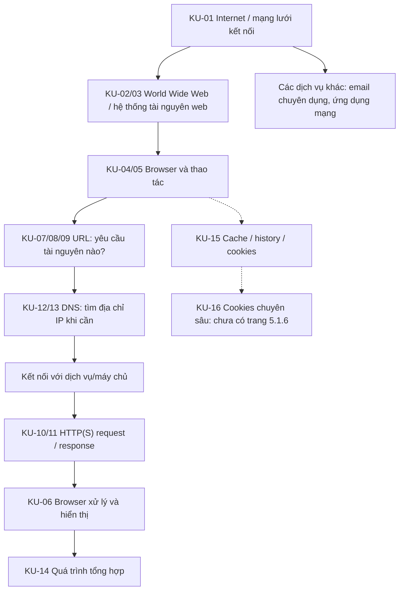

# 01 – CONTENT RESEARCH & ANALYSIS
## Bài 5.1: The Internet and the World Wide Web (WWW)

**Skill:** `01-content-research-analysis` · **Phiên bản:** v3.1  
**Lesson version:** WWW-5.1 / content-map 1.0 · **Ngày nghiên cứu:** 11/11/2026  
**Trạng thái:** **PASS – trong phạm vi 5.1.1–5.1.5**; phần 5.1.6 chưa đủ tư liệu.  
**Đầu vào:** 4 ảnh sách giáo khoa, trang 180–183 (`image(20261110-095309).png`, `...095325`, `...095333`, `...095342`); kết quả kế hoạch/trao đổi trước đây chỉ dùng để hiểu bối cảnh, **không dùng thay cho nguồn sách**.  
**Đối tượng:** một học sinh học cùng một giáo viên (gia sư 1–1); chưa xác nhận lớp và mức độ kiến thức ban đầu.  
**Quỹ thời gian tham chiếu:** 120 phút theo kế hoạch trước; **chưa phân bổ thời gian từng đơn vị ở Skill 01**.  
**Ngôn ngữ chuẩn hóa:** thuật ngữ gốc tiếng Anh, diễn giải tiếng Việt.

> **Ranh giới trách nhiệm:** Tài liệu này nghiên cứu nội dung và kiến thức chuẩn, KHÔNG chọn phương pháp giảng dạy, hoạt động, bài tập về nhà, mô hình/slide hoặc kịch bản. Các quyết định đó thuộc Skills 02–11.

---

## A. Đối chiếu trực tiếp với tài liệu gốc

| Trang | Mục sách/ảnh | Những yêu cầu tối thiểu đọc được | Ghi chú phạm vi |
|---|---|---|---|
| 180 | Mục 5.1.1, *The differences between the internet and the World Wide Web (WWW)* | Internet là hệ thống mạng kết nối; WWW là phần/dịch vụ trên Internet để truy cập các tài nguyên web; không đồng nhất hai thuật ngữ. | Cần thống nhất khái niệm network of networks và web resources. |
| 181 (đầu trang) | Table 5.1 | So sánh Internet vs WWW: email, chatting, TCP/IP; web page, URL, browser, web server, HTTP(S)/HTML. | Đây là các ví dụ và đặc điểm phổ biến, không phải quy tắc phân chia tuyệt đối mọi ứng dụng. |
| 181 | Mục 5.1.2, *Uniform resource locators (URLs)* | URL là địa chỉ tài nguyên; dạng minh họa `protocol://website address/path/file name`; HTTP/HTTPS; domain host, domain name, domain type, country code; path và filename có thể vắng. | Sách dùng cách đơn giản hóa phù hợp cấp học; bổ sung các ngoại lệ cần thiết để tránh hiểu sai. |
| 181 | Mục 5.1.3, *HTTP and HTTPS* | HTTP là bộ quy tắc trao đổi nội dung web; HTTPS có lớp bảo vệ truyền thông; sách nhắc SSL/TLS và biểu tượng khóa. | Cần cập nhật TLS, ý nghĩa HTTPS và giao diện trình duyệt hiện nay. |
| 182 | Mục 5.1.4, *Web browsers* | Browser truy cập và hiển thị trang; diễn giải HTML, xử lý tài nguyên; các tính năng: home, favourites/bookmarks, history, back/forward, tabs, cookies, hyperlinks/new tab, cache, JavaScript, address bar. | Không bỏ quên cache, cookies, JavaScript chỉ vì khó minh họa; nhưng cookies sâu thuộc 5.1.6 (chưa có). |
| 183 | Mục 5.1.5, *Retrieval and location of web pages* | HTML lưu trữ trên web server, IP, DNS và nhiều DNS server; sơ đồ 5 bước: nhập URL → tra DNS → nhận IP → liên hệ máy chủ → nhận nội dung và browser hiển thị. | Mô hình minh họa, không khẳng định là con đường duy nhất hoặc mỗi lần đều hỏi nhiều DNS server. |

### Phạm vi chưa có trong ảnh
- Mở đầu chương tại trang 180 có **nhắc trước** cookies, phân loại session/persistent; trang 182 dẫn *Section 5.1.6*. **Không có nội dung mục 5.1.6 trong ảnh**. Đánh dấu `PENDING_SOURCE`, không tự mở rộng thành một đơn vị bắt buộc.
- Digital currency, blockchain, cyber security là **các mục/chủ đề khác trong chương 5**, không thuộc phạm vi 5.1.1–5.1.5. Chỉ nhắc khi làm ngữ cảnh, không thêm vào đích học.
- Tên sách, ấn bản/năm xuất bản và chuẩn kiểm tra cụ thể chưa được cung cấp: không suy diễn.

## B. Bản đồ các đơn vị kiến thức (Knowledge Units)

**Quy ước:** `CORE` = bắt buộc từ ảnh; `SUPPORT` = bổ trợ để hiểu đúng; `EXTENSION` = mở rộng có điều kiện; `BOUNDARY` = có nhắc nhưng ngoài phạm vi ảnh. Độ khó Thấp/Vừa/Cao là đánh giá sư phạm **sơ bộ**, cần điều chỉnh khi biết trình độ học sinh.

| KU | Nội dung chuẩn hóa | Loại kiến thức | Tiên quyết | Phạm vi | Độ khó | Hiểu lầm cần phòng | Nguồn |
|---|---|---|---|---|---|---|---|
| **KU-01** | Internet: hệ thống toàn cầu gồm nhiều mạng liên kết; thiết bị trao đổi dữ liệu trên hạ tầng và các giao thức mạng. | Khái niệm / cấu trúc | Thiết bị, mạng cơ bản | CORE | Vừa | Internet = một website/ứng dụng; chỉ có một máy chủ Internet. | SGK 180, S1, S2 |
| **KU-02** | WWW/Web: hệ thống tài nguyên web liên kết qua hyperlinks, truy cập qua Internet, thường bằng browser. | Khái niệm | KU-01 | CORE | Vừa | WWW = toàn bộ Internet; WWW chỉ gồm trang HTML tĩnh. | SGK 180–181, S1, S2 |
| **KU-03** | Quan hệ Internet–WWW; phân biệt dịch vụ web với dịch vụ Internet khác trong ngữ cảnh cụ thể. | So sánh / phân loại | KU-01,02 | CORE | Vừa | Tất cả email, gọi video, game đều không phải web; hoặc tất cả đều là web. | SGK 181, S1 |
| **KU-04** | Web browser: phần mềm client dùng để truy cập và hiển thị các tài nguyên web; browser ≠ website ≠ search engine. | Khái niệm / thao tác | KU-02 | CORE (+ phân biệt bổ trợ) | Thấp | Chrome = Google Search; browser chính là Internet. | SGK 182, S2, S6 |
| **KU-05** | Các thành phần/chức năng giao diện browser: address bar, homepage, tabs, links, back/forward, history, bookmarks/favourites; mở link trong tab mới. | Thao tác / chức năng | KU-04 | CORE | Thấp–vừa | Bookmark = history; new tab = back; giao diện mọi browser giống nhau. | SGK 182 |
| **KU-06** | Browser nhận và dựng nội dung: HTML tạo cấu trúc, CSS hình thức, JavaScript tương tác, media; cache và dữ liệu trình duyệt có thể ảnh hưởng truy cập. | Cơ chế / chức năng | KU-04 | CORE (HTML/JS/cache) + SUPPORT (CSS) | Vừa | Browser chỉ 'đọc một file HTML' là xong; mỗi lần phải tải lại mọi tài nguyên. | SGK 182–183, S2, S6 |
| **KU-07** | URL = Uniform Resource Locator: địa chỉ xác định tài nguyên và cách truy cập; đường dẫn URL không đồng nhất với từ khóa tìm kiếm. | Khái niệm / quy ước | Browser, web resource | CORE | Thấp | URL phải là tên miền; nhập từ khóa tìm kiếm cũng là một URL. | SGK 181, S3 |
| **KU-08** | Cấu trúc URL web: scheme `http`/`https`, host (thường là domain), subdomain, domain/TLD, path; filename là một *kiểu phần cuối path* nếu có. | Quy ước / phân tích | KU-07 | CORE | Vừa | `www` bắt buộc; đuôi `.html` bắt buộc; TLD là phần giống path. | SGK 181, S3 |
| **KU-09** | URL có thể gồm port, query `?`, fragment `#`; path có thể đại diện route, không phải file vật lý; host có thể là IP. | Quy ước / trường hợp biên | KU-08 | SUPPORT | Vừa | Mọi path là thư mục thật; query/fragment là tên miền. | S3, S11 |
| **KU-10** | HTTP là giao thức trao đổi theo request–response giữa client và server; phản hồi chứa tài nguyên hoặc kết quả/trạng thái khác. | Cơ chế | KU-04,07 | CORE | Vừa | HTTP = ngôn ngữ HTML; mỗi lần đều nhận trang thành công. | SGK 181,183; S2,S4 |
| **KU-11** | HTTPS là HTTP dùng kênh kết nối bảo vệ bằng TLS; bảo vệ truyền thông, không chứng minh nội dung website hợp pháp/đáng tin. | Khái niệm / an toàn số | KU-10 | CORE | Vừa | `https` hoặc biểu tượng khóa đồng nghĩa trang không lừa đảo. | SGK 181, S4,S7 |
| **KU-12** | IP address: địa chỉ mạng giúp định tuyến đến thiết bị/dịch vụ; domain là tên dễ nhớ; DNS phân giải tên miền sang bản ghi địa chỉ IP khi cần. | Cơ chế / định danh | KU-01,07,08 | CORE | Vừa | Mỗi tên miền cố định một IP; DNS tải nội dung trang web. | SGK 183, S2,S5 |
| **KU-13** | Hệ thống DNS có resolver và các máy chủ tên miền; kết quả có thể nằm trong cache, không nhất thiết cần truy vấn từ đầu mỗi lần. | Cơ chế / ngoại lệ | KU-12 | CORE (nhiều DNS) + SUPPORT (cache) | Vừa–cao | Chỉ tồn tại một 'DNS server'; luôn có đúng năm bước cứng. | SGK 183, S5 |
| **KU-14** | Hành trình truy cập một trang web ở mức tổng quan: xác định URL → khi cần tìm địa chỉ qua DNS → thiết lập kết nối → HTTP(S) request/response → browser nhận tài nguyên, render. | Cơ chế tổng hợp | KU-01–13 | CORE | Cao | DNS gửi nội dung trang; HTTP tự hiển thị; chỉ có một request cho toàn trang. | SGK 183, S2,S4,S6 |
| **KU-15** | Trình duyệt có thể dùng cache, history và cookies cho các mục đích khác nhau; cookie thường lưu trạng thái, khác history và cache. | Phân biệt khái niệm | KU-04–06 | SUPPORT trong mục browser | Vừa | Cookies = cache = history; cookie luôn là mật khẩu. | SGK 182, S10 |
| **KU-16** | Session cookies / persistent cookies và vòng đời chi tiết. | Định nghĩa / cơ chế | KU-15 | BOUNDARY – PENDING_SOURCE 5.1.6 | Chưa xếp | Suy đoán nội dung chương từ mục lục. | SGK 180 dẫn trước, 182 dẫn 5.1.6 |

### Ghi chú chốt kiến thức theo từng KU

- **KU-01–03:** Internet là nền tảng kết nối mạng; Web là một hệ thống/thành phần dịch vụ hoạt động dựa trên Internet. Một ứng dụng email chuyên dụng có thể trao đổi thư qua giao thức email khác HTTP; **webmail mở bằng browser** là một ứng dụng web. Không dùng nhãn tuyệt đối theo tên ứng dụng nếu không biết giao thức/đường truy cập. Khái niệm Internet không chỉ gắn với TCP: Internet có nhiều giao thức và các cơ chế truyền khác nhau.
- **KU-04–06:** Phân biệt **browser** (Chrome/Firefox/Edge), **website** (tài nguyên/dịch vụ được truy cập), và **search engine** (dịch vụ tìm kiếm có thể mở trong browser). Bookmark là lưu trang có chủ ý; history là lịch sử duyệt nếu được ghi; cache giữ lại tài nguyên để sử dụng lại; cookies là các mẩu dữ liệu nhỏ để duy trì trạng thái/trợ giúp nhận diện phiên. Không xem hình chụp giao diện SGK là biểu diễn bất biến của phần mềm.
- **KU-07–09:** Dùng `https://www.example.org/articles/intro.html` để bóc tách; `https` là scheme, `www` là subdomain thường gặp, `example.org` là domain, `/articles/intro.html` là path. Nếu có `.html`, phần `intro.html` trông như tên tệp, **không suy ra phải có tệp vật lý như vậy**. Không yêu cầu `www`, phần mở rộng hoặc path rõ ràng trong mọi URL. URL có thể thêm `?q=web`, `#summary`. Domain và TLD là thành phần của host, không phải nội dung path.
- **KU-10–11:** HTTP quy định cách client/server trao đổi *requests* và *responses*, **không phải** ngôn ngữ tạo bố cục (HTML). HTTP(S) là giao thức web; HTTPS bảo vệ dữ liệu khi truyền và xác thực điểm kết nối theo TLS, không tự kiểm chứng độ chân thật của nội dung. Tránh lời giải thích lỗi thời 'SSL, ổ khóa màu xanh chứng tỏ site an toàn'.
- **KU-12–14:** DNS là **Domain Name System** (hệ thống tên miền), không nên đồng nhất cả hệ thống với một **Domain Name Server**. Truy vấn có thể được trả lời từ cache; cùng tên miền có thể ánh xạ đến nhiều IP hoặc thay đổi theo khu vực/thời điểm. IP không phải địa chỉ của riêng một 'trang HTML'. DNS không trả về nội dung web. Sau khi nhận phản hồi, browser có thể yêu cầu thêm CSS/JS/ảnh; mô hình một request + một response chỉ là giản lược.
- **KU-16:** Không tự tạo nội dung dạy bắt buộc nếu chưa có trang SGK 5.1.6. Có thể định nghĩa cookie một câu để giải thích danh sách browser, không dạy chuyên đề cookie.

---

## C. Bản đồ mối quan hệ kiến thức

**Chú ý:** Đây là **quan hệ tri thức và một luồng diễn giải sư phạm**, không phải thứ tự duy nhất của mọi lần tải web. Có thể không cần tra DNS mới; kết nối có thể được tái sử dụng; nội dung có thể lấy từ cache; một trang web có thể sinh nhiều request.

### Các nút phụ thuộc chặt
1. Muốn giải thích DNS phải phân biệt domain name và IP address; không yêu cầu đã thuộc chi tiết query/fragment.
2. Muốn giải thích HTTP cần hiểu client (browser), server, request, response và tài nguyên.
3. Muốn tổng hợp truy cập web cần nối URL + DNS/IP + HTTP(S) + browser/render; học một thuật ngữ rời rạc không đủ.
4. Phân biệt browser / search engine làm rõ thao tác thực tế; không nhất thiết phải là một đơn vị bài riêng.

---

## D. Các kiến thức thực tế được nghiên cứu và đề nghị bổ sung

| Mã | Kiến thức đời thực | Lợi ích làm rõ SGK | Mức | Độ tin cậy |
|---|---|---|---|---|
| F-01 | Mở Gmail qua trang web và dùng một email client riêng có thể sử dụng các giao thức khác nhau. | Xóa hiểu lầm 'email = WWW' hoặc 'email ≠ WWW' trong mọi trường hợp. | SUPPORT | Cao (theo định nghĩa Web, trường hợp có điều kiện) |
| F-02 | Trên cùng tên miền, `/news` và `/about` có thể chỉ hai tài nguyên/trang/route khác nhau. | Giải thích khác nhau giữa host và path. | SUPPORT | Cao (S3) |
| F-03 | Trình duyệt hiện đại dùng thanh địa chỉ có thể chứa URL hoặc từ khóa tìm kiếm. | Browser không đồng nghĩa search engine; tránh mặc định mọi chuỗi nhập đều là URL. | SUPPORT | Cao (kiến thức thực tế, giao diện tùy ứng dụng) |
| F-04 | DNS có cache; lỗi web chưa chắc do DNS; cùng tên miền có thể có nhiều địa chỉ. | Không dạy sơ đồ 5 bước như luồng bất biến. | SUPPORT | Cao (S5) |
| F-05 | HTTPS tạo kênh truyền bảo vệ, nhưng website lừa đảo cũng có thể sử dụng HTTPS. | An toàn số mức cơ bản, cập nhật sách cũ. | CORE correction | Cao (S7) |
| F-06 | Browser có thể tải thêm CSS, JS, ảnh sau HTML; trang hiển thị có thể thay đổi do JS. | Hiểu đúng browser render thay vì 'chỉ dịch HTML'. | SUPPORT | Cao (S6) |
| F-07 | Web được tạo tại CERN năm 1989 để chia sẻ thông tin giữa các nhà khoa học. | Ngữ cảnh lịch sử ngắn giúp phân biệt Internet có trước WWW. | EXTENSION | Cao (S8) |
| F-08 | Cookies, browser history và HTTP cache phục vụ những nhiệm vụ khác nhau. | Không nhầm ba tính năng có trong trang 182. | SUPPORT (giới hạn) | Cao (S10) |
| F-09 | HTTP/3 có thể dùng QUIC; mô tả 'tất cả HTTP luôn dùng TCP' không đúng ở mọi phiên bản. | Lưu ý chuẩn xác cho giáo viên; không yêu cầu học sinh học QUIC. | TEACHER-ONLY | Cao (S9) |

---

## E. Tình huống có vấn đề để Skill 02–04 xem xét (chưa chọn hoạt động)

| Mã | Tình huống / câu hỏi gợi mở | Loại tình huống | KU liên quan | Bằng chứng/tri thức cần sử dụng | Giới hạn |
|---|---|---|---|---|---|
| C-01 | “Nếu một website không truy cập được, Internet có chắc đã mất không?” | Trường hợp điển hình | 01–03, 12–14 | Phân biệt Web và kết nối Internet; nhiều nguyên nhân lỗi web. | Không nói mọi ứng dụng khác chắc chắn chạy. |
| C-02 | “Gửi email bằng ứng dụng độc lập và đọc webmail trên browser khác nhau thế nào?” | Trường hợp điển hình có điều kiện | 02–04 | Web app vs các giao thức/dịch vụ khác. | Không khẳng định mọi email client đều không dùng công nghệ web. |
| C-03 | “Vì sao hai URL cùng `example.org` dẫn tới hai nội dung khác nhau?” | Giả định sư phạm dùng domain dành cho tài liệu | 07–09 | Host chung, path khác. | Không trông chờ URL giả định mở trang thật. |
| C-04 | “Tại sao máy tính tìm được website khi em chỉ biết tên dễ nhớ, không biết IP?” | Câu hỏi cơ chế | 12–13 | DNS và cache/response. | DNS không phải nguồn chứa trang web. |
| C-05 | “Vì sao website có HTTPS vẫn có thể xuất hiện nội dung không đáng tin?” | Tình huống điển hình | 11 | Khác biệt bảo mật kết nối và độ tin cậy nội dung. | Không mô phỏng trang lừa đảo cụ thể. |
| C-06 | “Tại sao một trang web có thể hiện nội dung trước khi ảnh tải xong?” | Tình huống quan sát thực tế | 06,10,14 | Nhiều tài nguyên và nhiều request/render. | Hành vi cụ thể phụ thuộc browser/network. |
| C-07 | “Đã mở bài học rồi, lần sau tải lại có thể nhanh hơn vì sao?” | Trường hợp điển hình | 06,13,15 | Cache browser/DNS, không đồng nhất chúng. | Không hứa cache luôn làm nhanh hơn. |
| C-08 | “Chrome và Google Search có giống nhau không?” | Tình huống thực tế | 04–05 | Browser vs search service. | Cần nói rõ giao diện address bar có tìm kiếm. |
| C-09 | “Khi trình duyệt báo 404, điều đó có nhất thiết nghĩa là mất Internet?” | Trường hợp điển hình | 10,14 | Server response/status code, khác lỗi kết nối. | 404 là bổ trợ, không mở rộng quá trọng tâm. |
| C-10 | “Nếu giả định WWW ngừng hoạt động nhưng Internet còn, ứng dụng nào còn dùng được?” | **Thí nghiệm tư duy** | 01–03 | Quan hệ hạ tầng và dịch vụ. | Không xem là sự kiện thật; phải xác định ứng dụng nào độc lập với web. |

**Cảnh báo:** Các tình huống ở mục E là *kho ngữ cảnh để lựa chọn ở Skill 03/04*, không phải mười hoạt động bắt buộc, không phải đề bài đã hoàn chỉnh.

---

## F. Những định nghĩa và phát biểu chuẩn dùng thống nhất

| Thuật ngữ | English – concise | Tiếng Việt dành cho học sinh | Ghi chú chuẩn xác |
|---|---|---|---|
| Internet | A global system of interconnected computer networks. | Hệ thống các mạng máy tính kết nối với nhau trên toàn cầu. | Là hạ tầng/kết nối, không phải riêng WWW. |
| World Wide Web | A system of interlinked web resources accessible over the Internet. | Hệ thống các tài nguyên web liên kết với nhau và được truy cập qua Internet. | Không chỉ website HTML tĩnh. |
| Web browser | Software used to retrieve and display web content. | Phần mềm dùng để truy cập và hiển thị nội dung web. | Phân biệt search engine. |
| URL | Uniform Resource Locator; an address used to locate and access a resource. | Địa chỉ xác định tài nguyên và cách truy cập tài nguyên. | URL không bắt buộc có `www`, `.html`. |
| Domain name | A human-readable name used to identify an Internet domain/host. | Tên miền dễ đọc, có thể được phân giải để tìm địa chỉ mạng. | Một tên miền không nhất thiết có một IP duy nhất. |
| IP address | A numerical network address used to identify/address an interface. | Địa chỉ số dùng trong mạng để liên lạc và định tuyến. | Tránh gọi là địa chỉ của riêng 'trang web'. |
| DNS | Domain Name System. | Hệ thống tên miền, giúp tìm thông tin địa chỉ (chẳng hạn IP) từ tên miền. | Phân biệt DNS system với DNS server. |
| HTTP | Hypertext Transfer Protocol. | Giao thức trao đổi yêu cầu và phản hồi để truy cập tài nguyên web. | Không phải HTML. |
| HTTPS | HTTP over a protected connection using TLS. | HTTP qua kết nối được bảo vệ bằng TLS. | Không chứng minh website đáng tin. |
| HTML | HyperText Markup Language. | Ngôn ngữ đánh dấu mô tả cấu trúc nội dung trang web. | Không gọi HTML là 'giao thức'. |
| Hyperlink | A link to another resource or location. | Liên kết dẫn tới tài nguyên hay vị trí khác. | Là nền tảng liên kết trên Web. |
| Web server | A server that handles web requests and sends web resources/responses. | Máy chủ/dịch vụ xử lý yêu cầu web và gửi phản hồi. | Địa chỉ IP của máy không đồng nghĩa duy nhất một website. |
| Cache | Stored data/resources that can be reused. | Dữ liệu/tài nguyên tạm lưu để có thể dùng lại. | Browser cache khác DNS cache. |
| Cookie | A small piece of data that a website/server may store in a browser. | Mẩu dữ liệu nhỏ giúp duy trì một số trạng thái tương tác web. | Chuyên sâu thuộc mục 5.1.6 chưa có ảnh. |

### Ví dụ URL được kiểm soát về độ đúng

1. `https://www.example.org/science/index.html` → `scheme = https`, `host = www.example.org`, `subdomain = www`, `domain = example.org`, `path = /science/index.html`; `index.html` là tên tệp trong **cách đặt tên của ví dụ**, không phải bằng chứng về file thật.
2. `https://example.org/library/books` → `www` vắng; không có hậu tố `.html`; đường dẫn `/library/books` có thể do ứng dụng định tuyến.
3. `https://example.org/search?q=internet#results` → có query `?q=internet` và fragment `#results` (SUPPORT, không bắt thuộc lòng nếu thời lượng giới hạn).
4. `192.0.2.10` → **IP IPv4 chỉ dùng làm giá trị giả định minh họa**, thuộc dải tài liệu; không tuyên bố là IP đang phục vụ `example.org`.

Dùng các tên miền `example.org`, `example.com`, `example.net` để minh họa; đây là các domain dành cho ví dụ tài liệu theo IANA. Không giả định các URL mẫu sẽ tải được trang thật. [S12]

---

## G. Phân biệt tài liệu SGK với kiến thức được cập nhật

| Chi tiết trong SGK | Nguy cơ hiểu sai khi giữ nguyên | Cách diễn đạt chuẩn hóa | Nguồn |
|---|---|---|---|
| Internet viết như “INTERconnected NETwork” | Dễ xem là nguồn gốc chính thức, không cần cho mục tiêu. | Tập trung định nghĩa hệ thống các mạng liên kết; không đánh giá cách tách chữ. | S1 |
| WWW là “part of internet” | Dễ lẫn một mạng con vật lý với hệ thống tài nguyên/dịch vụ. | WWW là hệ thống tài nguyên web được xây dựng trên Internet. | S1 |
| Email/chat ở cột Internet, web ở cột WWW | Dễ phân loại ứng dụng tuyệt đối theo tên. | Phân loại theo **cách truy cập và giao thức cụ thể**; webmail là ứng dụng web. | S1,S2 |
| URL dạng `protocol://website/path/filename` | Dễ nghĩ `www`, đường dẫn, file đều bắt buộc. | Đây là một dạng ví dụ cho web URL; host/path/filename có các tùy chọn/ngoại lệ. | S3,S11 |
| HTTP vs HTTPS giải thích chủ yếu qua SSL và ổ khóa | Dễ kết luận biểu tượng khóa = trang uy tín; giao diện Chrome đã đổi. | HTTPS bảo vệ kênh truyền bằng TLS; không quyết định mức độ đáng tin của nội dung. | S7 |
| Browser “interprets HTML” | Dễ bỏ qua CSS, JS, nhiều asset và nhiều request. | Browser xử lý HTML/CSS/JS và tải thêm tài nguyên theo nhu cầu. | S6 |
| DNS là “Domain Name Server” hoặc một máy cụ thể | Lẫn hệ thống DNS với DNS server/recursive resolver. | DNS = **Domain Name System**, bao gồm nhiều vai trò máy chủ và bộ nhớ đệm. | S5 |
| DNS luôn theo 5 bước và cùng một IP | Sơ đồ SGK là mô hình tuyến tính; DNS có cache và nhiều địa chỉ. | Diễn đạt “trong ví dụ khi cần phân giải”, không khẳng định là mọi lần truy cập. | S5 |
| HTTP dùng TCP/IP | Có thể bị hiểu mọi phiên bản HTTP đều dùng TCP. | Ở mức phổ thông nói HTTP chạy qua các kết nối mạng; HTTP/3 có thể dùng QUIC. | S9 |

---

## H. Nội dung cần giữ lại / cần hoãn / không đi sâu

### Bắt buộc bảo toàn từ SGK
- Internet và WWW, mối quan hệ và ví dụ khác nhau.
- Ý nghĩa URL, scheme HTTP/HTTPS, host/domain, domain type/country code trong ví dụ, path, file name, và tính tùy chọn tương đối.
- HTTP và HTTPS, vai trò trao đổi và ý nghĩa bảo vệ kết nối.
- Browser: công dụng, address bar; home, tabs, bookmarks/favourites, history, navigation, hyperlinks/new tabs; HTML và JavaScript, cache và cookies ở mức giới thiệu.
- IP, DNS, nhiều DNS server, quan hệ từ URL đến truy cập web server và browser hiển thị HTML.

### Bổ trợ nên có để tránh sai kiến thức
- Phân biệt browser – search engine; webmail – email client.
- `www` không bắt buộc, path không nhất thiết chỉ file; DNS không luôn truy vấn từ đầu.
- Browser có nhiều request và có CSS/JS/assets.
- HTTPS không chứng nhận nội dung đáng tin.

### Mở rộng tùy chọn, không trở thành phần đánh giá bắt buộc
- Lịch sử ra đời Web tại CERN; query/fragment của URL; trạng thái HTTP 200/404; DNS cache hit/miss và nhiều IP; cache trình duyệt ở mức giải thích; khác biệt sơ bộ HTTP/3 (chỉ chú thích GV).

### Không đưa vào khi chưa có chỉ định/tư liệu
- Chuyên đề cookies 5.1.6: session vs persistent, chính sách tracking.
- Cryptocurrency, blockchain, cyber attacks chuyên sâu; cú pháp lập trình web chi tiết; mọi tầng của OSI/TCP/IP; TLS handshake, DNS root/TLD/authoritative đầy đủ; RFC HTTP/3 nâng cao.

---

## I. Hồ sơ nguồn tham khảo, ghi chú tin cậy

**Ngày đối chiếu trực tuyến:** 11/11/2026. Nguồn tài liệu kỹ thuật chính thống được ưu tiên; không sao chép dài từ nguồn, chỉ chuẩn hóa nội dung.

| ID | Tài liệu / Nhà xuất bản | URL hoặc nguồn | Vai trò & mức tin cậy |
|---|---|---|---|
| **SGK** | *Chapter 5 – The internet and its uses*, pp.180–183, ảnh do người dùng cung cấp; chưa xác minh ấn bản | 4 ảnh đã nhận trong cuộc trò chuyện | **Nguồn bắt buộc** để giữ phạm vi; một số phát biểu kỹ thuật cần cập nhật. |
| **S1** | MDN Web Docs – *World Wide Web* | https://developer.mozilla.org/en-US/docs/Glossary/World_Wide_Web | Cao; phân biệt Web/Internet và đặc điểm hyperlinks. |
| **S2** | MDN Web Docs – *How the web works* | https://developer.mozilla.org/en-US/docs/Learn_web_development/Getting_started/Web_standards/How_the_web_works | Cao; client/server, DNS, HTTP, URL, browser. |
| **S3** | MDN Web Docs – *What is a URL?* | https://developer.mozilla.org/en-US/docs/Learn_web_development/Howto/Web_mechanics/What_is_a_URL | Cao; cấu trúc URL, trường hợp tùy chọn, path và query/fragment. |
| **S4** | MDN Web Docs – *Overview of HTTP* | https://developer.mozilla.org/en-US/docs/Web/HTTP/Guides/Overview | Cao; HTTP request/response. |
| **S5** | Cloudflare Learning Center – *What is DNS?* | https://www.cloudflare.com/learning/dns/what-is-dns/ | Cao; DNS resolver, cache, nhiều máy chủ. Nguồn nhà cung cấp, chỉ dùng phần mô tả kỹ thuật. |
| **S6** | MDN Web Docs – *How browsers load websites* | https://developer.mozilla.org/en-US/docs/Learn_web_development/Getting_started/Web_standards/How_browsers_load_websites | Cao; HTML/CSS/JS và rendering, nhiều tài nguyên. |
| **S7** | Chromium Blog (Google) – *An Update on the Lock Icon* (02/05/2023) | https://blog.chromium.org/2023/05/an-update-on-lock-icon.html | Cao; trường hợp cập nhật UI của Chrome và giới hạn HTTPS. |
| **S8** | CERN – *Where the web was born* | https://home.cern/science/computing/the-birth-of-the-web/where-web-was-born/ | Cao; bối cảnh lịch sử Web (mở rộng). |
| **S9** | IETF/RFC Editor – *RFC 9114: HTTP/3* (06/2022) | https://www.rfc-editor.org/rfc/rfc9114.html | Rất cao; ghi chú cho giáo viên về QUIC, không đưa chi tiết vào bài. |
| **S10** | MDN Web Docs – *Using HTTP cookies* | https://developer.mozilla.org/en-US/docs/Web/HTTP/Guides/Cookies | Cao; cookie căn bản, không thay SGK 5.1.6. |
| **S11** | MDN Web Docs – *URI reference* | https://developer.mozilla.org/en-US/docs/Web/URI/Reference | Cao; phân biệt authority/path/query/fragment. |
| **S12** | IANA – *Example Domains* (cập nhật 27/09/2026) | https://www.iana.org/help/example-domains | Rất cao; tên miền dành riêng cho tài liệu; dịch vụ web ví dụ không được bảo đảm hoạt động. |

### Những khẳng định cần giới hạn độ chắc chắn
1. **Bản sách gốc**: đã đọc đủ 4 trang, nhưng **chưa có bìa/tên ấn bản**, không xác nhận thêm các trang ngoài phạm vi.
2. **Năng lực ban đầu của học sinh**: chưa được đo/khảo sát trong lượt này; độ khó KU chỉ là ước lượng để chuyển bước.
3. **IP 107.162.140.19** và trang `hoddereducation.co.uk` trong hình SGK: là **ví dụ tại thời điểm biên soạn**, không xác nhận giá trị còn hiện hành. Trong mô hình bài giảng dùng IP tài liệu riêng `192.0.2.10`, tên miền ví dụ và chú thích giả định.
4. **Mọi ví dụ lỗi website** đều có thể có nhiều nguyên nhân, không quy nạp một biểu hiện ra một lỗi DNS/Internet nhất định.
5. **Giấy phép ảnh/video/biểu đồ bên ngoài**: chưa kiểm tra ở Skill 01; đó là trách nhiệm thẩm định cụ thể của Skill 02.

---

## J. Traceability – hợp đồng bàn giao cho quy trình sau

Các mã OBJ/ACT/RES/SL chưa được tạo nên phải để `TBD` (đúng giai đoạn) theo Skill 01.

| Nhóm KU | OBJ | ACT | RES | Evidence | SL | Trạng thái |
|---|---|---|---|---|---|---|
| KU-01–03 | TBD–03 | TBD–04 | TBD–02/05 | TBD–03 | TBD–09/10 | Có kiến thức chuẩn, chưa thiết kế học tập |
| KU-04–06,15 | TBD–03 | TBD–04 | TBD–02/05 | TBD–03 | TBD–09/10 | Có kiến thức chuẩn; KU-15 chỉ hỗ trợ |
| KU-07–09 | TBD–03 | TBD–04 | TBD–02/05 | TBD–03 | TBD–09/10 | Có kiến thức chuẩn, không biến ngoại lệ thành nội dung cốt lõi |
| KU-10–11 | TBD–03 | TBD–04 | TBD–02/05 | TBD–03 | TBD–09/10 | Có kiến thức chuẩn + cảnh báo HTTPS |
| KU-12–14 | TBD–03 | TBD–04 | TBD–02/05 | TBD–03 | TBD–09/10 | Có cơ chế chuẩn + điều kiện giản lược |
| KU-16 | TBD | TBD | TBD | TBD | TBD | **PENDING_SOURCE – ngoài phạm vi ảnh** |

### Handoff cho Skill 02 – Learning Resource Curator

**Đầu vào đã sẵn sàng:**
1. Bảng 15 KU trong phạm vi (KU-01–15), 1 KU chờ tài liệu (KU-16).
2. Danh sách 12 nguồn (gồm SGK), 10 ngữ cảnh đời thực/giả định phân loại minh bạch.
3. Bộ thuật ngữ song ngữ, ví dụ URL và IP dành cho tài liệu an toàn.
4. Các điểm phải sửa so với SGK: HTTPS, DNS caching, tên miền/IP, trình duyệt, URL, cookies và tính cũ của hình giao diện.

**Việc Skill 02 cần thực hiện (chưa thực hiện):** tìm, đánh giá và mô tả học liệu có giấy phép (hình ảnh giao diện, clip minh họa, mô hình mạng, tài liệu ngắn, tư liệu riêng), phương án tự tạo SVG/JS, bản song ngữ, độ khó và tính chính xác của mỗi tài nguyên. **Không tự chọn hoạt động dạy học ở Skill 02.**

## K. Gate review Skill 01

- [x] Đã đọc đầy đủ 4 ảnh trang 180–183.
- [x] Đã bảo toàn nội dung tối thiểu của mục 5.1.1–5.1.5 (bao gồm danh sách browser, DNS nhiều máy chủ, HTML/JS/cache/cookies giới thiệu).
- [x] Đã phân rã KU theo loại, tiên quyết, khó khăn, phạm vi, hiểu lầm và nguồn.
- [x] Đã có mối quan hệ KU, định nghĩa chuẩn hóa, trường hợp ngoại lệ/giản lược.
- [x] Đã tìm tình huống thực tế và phân biệt thật/giả định/điển hình.
- [x] Đã đối chiếu nguồn kỹ thuật và lưu URL + ngày truy cập.
- [x] Chưa nhảy sang chọn phương pháp/hoạt động/website.
- [ ] Chưa có 5.1.6; đây là **giới hạn phạm vi**, không phải lỗi trong các KU 01–15.
- [ ] Chưa xác minh ấn bản sách và trình độ học sinh; không cản bước 02, nhưng phải ghi giả định.

**Kết luận gate:** **PASS cho phạm vi đã nhận (5.1.1–5.1.5)**; `KU-16` treo `PENDING_SOURCE`.  
**File đầu ra chính thức:** `01-content-map-internet-www-v3.1.md`  
**Bước kế tiếp:** Skill 02 – Learning Resource Curator.