# Đường đi buổi học demo — 19 scene, 120 phút

```mermaid
flowchart TD
  OPEN["OPEN · GAME_OPEN · 7.0 phút"]
  D_TEACH["D-TEACH · TEACH · 6.0 phút"]
  OPEN --> D_TEACH
  D_EXPLORE["D-EXPLORE · EXPLORE · 10.0 phút"]
  D_TEACH --> D_EXPLORE
  D_RECALL["D-RECALL · ACTIVE_RECALL · 4.0 phút"]
  D_EXPLORE --> D_RECALL
  D_QUIZ["D-QUIZ · REVIEW_QUIZ · 5.0 phút"]
  D_RECALL --> D_QUIZ
  BR_D_H["BR-D-H · BRIDGE · 2.0 phút"]
  D_QUIZ --> BR_D_H
  H_TEACH["H-TEACH · TEACH · 8.0 phút"]
  BR_D_H --> H_TEACH
  H_EXPLORE["H-EXPLORE · EXPLORE · 13.0 phút"]
  H_TEACH --> H_EXPLORE
  H_RECALL["H-RECALL · ACTIVE_RECALL · 4.0 phút"]
  H_EXPLORE --> H_RECALL
  H_QUIZ["H-QUIZ · REVIEW_QUIZ · 5.0 phút"]
  H_RECALL --> H_QUIZ
  BREAK["BREAK · BREAK · 5.0 phút"]
  H_QUIZ --> BREAK
  BR_H_C["BR-H-C · BRIDGE · 2.0 phút"]
  BREAK --> BR_H_C
  C_TEACH["C-TEACH · TEACH · 9.0 phút"]
  BR_H_C --> C_TEACH
  C_EXPLORE["C-EXPLORE · EXPLORE · 13.0 phút"]
  C_TEACH --> C_EXPLORE
  C_RECALL["C-RECALL · ACTIVE_RECALL · 4.0 phút"]
  C_EXPLORE --> C_RECALL
  C_QUIZ["C-QUIZ · REVIEW_QUIZ · 5.0 phút"]
  C_RECALL --> C_QUIZ
  TRANSFER["TRANSFER · INTEGRATED_TRANSFER · 10.0 phút"]
  C_QUIZ --> TRANSFER
  EXIT["EXIT · ASSESS · 6.0 phút"]
  TRANSFER --> EXIT
  CLOSE["CLOSE · CLOSE · 2.0 phút"]
  EXIT --> CLOSE
```

Ba module dạy được nối bằng Bridge, Recall + Quiz trước phần tiếp, Transfer chung và EXIT độc lập. Đây chỉ là mô hình để kiểm thử skill, chưa được người dùng phê duyệt dạy thật.
